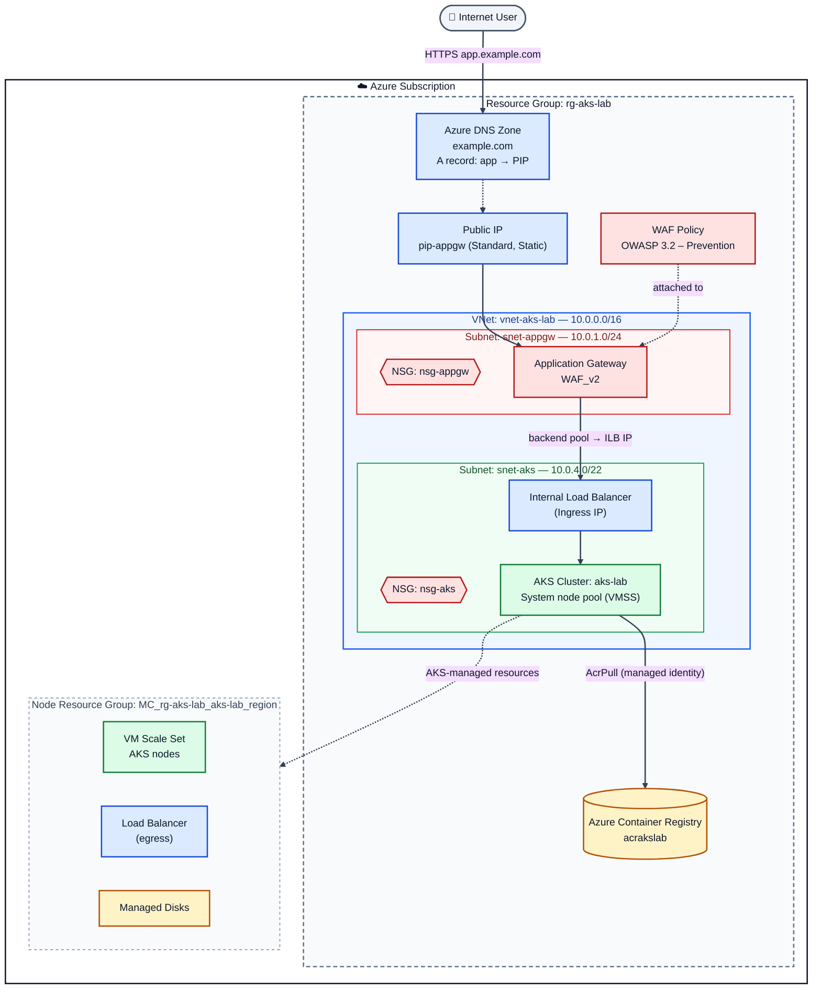

# AKS Lab – Azure Infrastructure

Azure infrastructure for the AKS lab (frontend/backend, Ingress, WAF, custom domain).

---

## 1. Infrastructure Diagram



**Legend:** 🟦 Network · 🟥 Security (WAF, NSG) · 🟩 Compute · 🟨 Storage/Registry

> Mermaid diagrams render natively in GitHub and Azure DevOps READMEs.

### Plain-text version

```
Internet ──HTTPS──► Azure DNS (app.example.com) ──► Public IP
                                                      │
┌──────────── Resource Group: rg-aks-lab ─────────────┼──────────────────┐
│                                                     ▼                  │
│  ┌──────── VNet: vnet-aks-lab (10.0.0.0/16) ─────────────────────────┐ │
│  │                                                                   │ │
│  │  snet-appgw (10.0.1.0/24)  [NSG]                                  │ │
│  │   └─ Application Gateway WAF_v2  ◄── WAF Policy (OWASP)           │ │
│  │              │                                                    │ │
│  │              ▼                                                    │ │
│  │  snet-aks (10.0.4.0/22)    [NSG]                                  │ │
│  │   ├─ Internal Load Balancer (Ingress IP)                          │ │
│  │   └─ AKS cluster – system node pool (VMSS)                        │ │
│  └───────────────────────────────┬───────────────────────────────────┘ │
│                                  │ AcrPull                             │
│  Azure Container Registry ◄──────┘                                     │
└────────────────────────────────────────────────────────────────────────┘

MC_rg-aks-lab_aks-lab_<region>  (created by AKS): VMSS, Load Balancer, Disks
```

---

## 2. Resources

| Resource | Name (example) | Notes |
|---|---|---|
| Resource Group | `rg-aks-lab` | Holds all lab resources |
| Virtual Network | `vnet-aks-lab` | `10.0.0.0/16` |
| App Gateway subnet | `snet-appgw` | `10.0.1.0/24`, dedicated to Application Gateway |
| AKS subnet | `snet-aks` | `10.0.4.0/22`, hosts nodes and the internal LB |
| NSG | `nsg-appgw`, `nsg-aks` | `nsg-appgw` must allow ports 65200–65535 from `GatewayManager` |
| Public IP | `pip-appgw` | Standard SKU, static |
| Application Gateway | `agw-aks-lab` | WAF_v2 SKU, terminates TLS for the custom domain |
| WAF Policy | `waf-aks-lab` | OWASP CRS, Prevention mode |
| AKS | `aks-lab` | System node pool on VMSS, Azure CNI networking |
| Internal Load Balancer | (created by the Ingress Service) | Private IP in `snet-aks`, used as the App Gateway backend |
| Container Registry | `acrakslab` | AKS is granted the `AcrPull` role |
| DNS Zone | `example.com` | A record `app` points to `pip-appgw` |
| Node Resource Group | `MC_rg-aks-lab_aks-lab_<region>` | Created and managed by AKS (VMSS, LB, disks) |

---

## 3. Traffic Flow

1. The user browses to `https://app.example.com`; Azure DNS resolves it to `pip-appgw`.
2. Application Gateway terminates TLS and the WAF Policy inspects the request.
3. Allowed requests are forwarded to the **Internal Load Balancer** (Ingress IP) in `snet-aks`.
4. The Ingress Controller on AKS routes the request to the frontend or backend.

---

## 4. Cost Notes

- Application Gateway WAF_v2 is billed hourly even with no traffic — **delete or stop it** when the lab isn't in use.
- Use `az aks stop` to pause the cluster.
